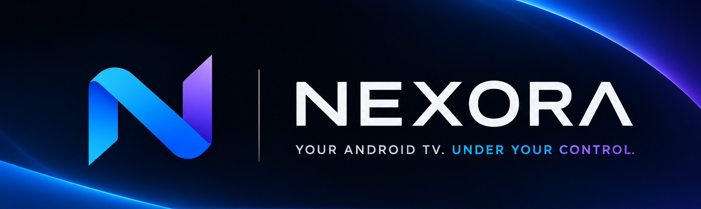

<p align="center">
  
</p>

# Nexora

**Your Android TV. Under your control.**

Nexora is an Android phone app that controls Android TV and set-top boxes
over ADB on your local network. The phone is the ADB host and the TV is the
target. There is no gateway, cloud backend or companion app on the TV.

> **Status:** early development. v0.1.0 is tested against a real Android 10
> set-top box (AX512) over TCP ADB.

## Download

Get the latest signed APK from
[Releases](https://github.com/drakhaw/nexora/releases/latest). It is a single
APK for every phone CPU type (`arm64-v8a`, `armeabi-v7a`, `x86_64`, `x86`).
Check it against the `.sha256` file published next to it.

## Features

| Area       | What it does                                                                 |
| ---------- | ---------------------------------------------------------------------------- |
| Devices    | Save several TVs, pair with Wireless Debugging or connect over legacy TCP ADB, auto-reconnect, revalidate when the app returns to the foreground or the network changes |
| Remote     | Round D-pad with OK, Home, Back, volume, mute, media and power keys; hold to repeat, long press; text input. Keys reach the TV in about 150 ms (see [Fast key input](#fast-key-input)) |
| Apps       | List, launch, force-stop, uninstall and install APKs                          |
| Tools      | Terminal (shell v2 with exit codes, history, saved commands), file browser with upload/download, screenshots |
| Monitor    | CPU, memory, storage, battery and uptime; values the device does not expose show as "Unavailable" |

## Requirements

- **Phone:** Android 8.0 (API 26) or newer.
- **TV/STB:** Android with Developer options enabled, plus either
  Wireless Debugging (Android 11+) or ADB over network (TCP, usually port 5555).
- Phone and TV on the same trusted Wi-Fi or Ethernet network.

## Build

Prerequisites: the Android SDK (platform 36). Gradle needs a JDK to run; the
JDK 17 toolchain used for compiling is downloaded automatically if it is not
installed. Missing SDK packages are installed by the Android Gradle plugin.

1. Point Gradle at your SDK in `local.properties` (not committed):

   ```properties
   sdk.dir=/path/to/Android/Sdk
   ```

2. Build and test:

   ```bash
   ./gradlew :app:assembleDebug
   ./gradlew :app:testDebugUnitTest
   ```

3. Install on a phone connected over USB:

   ```bash
   adb install -r app/build/outputs/apk/debug/app-debug.apk
   ```

## Release

`./gradlew :app:assembleRelease` builds an R8-minified APK. It is signed when
signing values are available, and unsigned otherwise.

**Local signing.** Create `keystore.properties` in the project root (ignored
by git). Keep the keystore itself outside the repository:

```properties
storeFile=/absolute/path/to/nexora-release.jks
storePassword=...
keyAlias=nexora
keyPassword=...
```

**CI signing.** The same values can come from the environment variables
`NEXORA_KEYSTORE_FILE`, `NEXORA_KEYSTORE_PASSWORD`, `NEXORA_KEY_ALIAS` and
`NEXORA_KEY_PASSWORD`.

**Publishing.** [.github/workflows/release.yml](.github/workflows/release.yml)
runs when a tag like `v0.1.0` is pushed. It runs the unit tests, builds and
verifies the signed APK, and publishes a GitHub Release with the APK and its
SHA-256. The tag must match `versionName` in `app/build.gradle.kts`.

It needs these repository secrets (Settings > Secrets and variables > Actions):

| Secret                     | Value                              |
| -------------------------- | ---------------------------------- |
| `NEXORA_KEYSTORE_BASE64`   | base64 of the `.jks` file          |
| `NEXORA_KEYSTORE_PASSWORD` | keystore password                  |
| `NEXORA_KEY_ALIAS`         | key alias                          |
| `NEXORA_KEY_PASSWORD`      | key password                       |

To cut a release, bump `versionCode` and `versionName`, commit, then:

```bash
git tag v0.1.0
git push origin v0.1.0
```

Back up the keystore and its password. Android only accepts updates signed
with the same key, so losing it means users must uninstall to upgrade.

## Connecting to a TV

1. On the TV, enable **Developer options** and either **Wireless debugging**
   or **ADB debugging / network debugging**.
2. In Nexora, open **Devices**:
   - **Pair** for Wireless Debugging: enter the pairing IP, port and code shown on the TV.
   - **Add device** for TCP ADB: enter the TV's IP and port (default `5555`).
3. Tap **Connect**. The first time, the card shows **Accept the debugging
   prompt on the TV…**: on the TV, tick **Always allow from this computer**
   and tap **Allow** within 60 seconds.

If the prompt does not appear, check that ADB debugging is still enabled on the
TV, then tap **Connect** again.

## Fast key input

`input keyevent` starts a new Java VM on the TV for every key, which takes
about a second on low-end set-top boxes. Nexora instead ships a small key
injector ([`app/src/inputserver`](app/src/inputserver)), built into a
standalone dex of a few KB and bundled as an asset.

When the Remote tab opens, the app pushes it to
`/data/local/tmp/nexora-input-<hash>.jar` (only when it changed), checks it
with `--check`, and starts it once under `app_process` as the shell user. Each
key press is then one line on its stdin and is injected in a few milliseconds.
Starting it takes 1–2 seconds. If any step fails, keys fall back to
`input keyevent`. Text is still sent with `input text`.

## Tech stack

Kotlin, Jetpack Compose (Material 3), Hilt, Room, DataStore, Navigation,
Coroutines/Flow. ADB transport uses
[libadb-android](https://github.com/MuntashirAkon/libadb-android); the shell
v2 and sync protocols are implemented in the app
(`core/adb/protocol`). The ADB host key is stored encrypted with an
Android Keystore key.

## Project layout

```
app/src/main/java/im/wisnu/nexora/
├── core/        ADB interfaces and libadb implementation, protocols, security, network, lifecycle
├── data/        Room database, repositories, DataStore preferences
├── domain/      Devices, remote, apps, tools, monitoring logic
├── feature/     Compose screens and ViewModels (devices, remote, apps, tools, monitoring, splash)
├── navigation/  App navigation
└── ui/theme/    Nexora design tokens and theme
app/src/inputserver/  Key injector that runs on the TV (see Fast key input)
.github/workflows/    Release workflow
media/                Brand assets (banner, splash reference)
```

## Support

If Nexora is useful to you, you can support development via
[PayPal](https://paypal.me/DRaWisnu).
